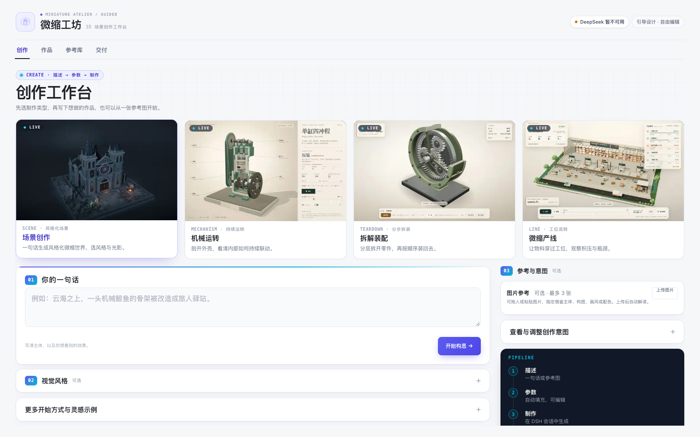
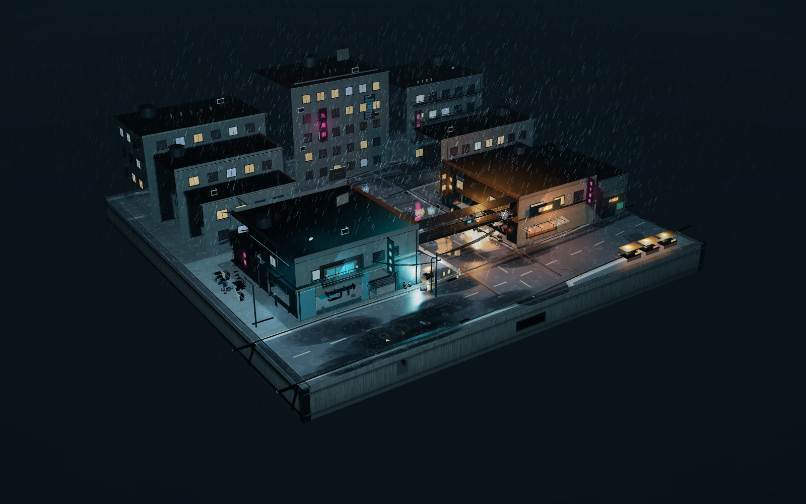
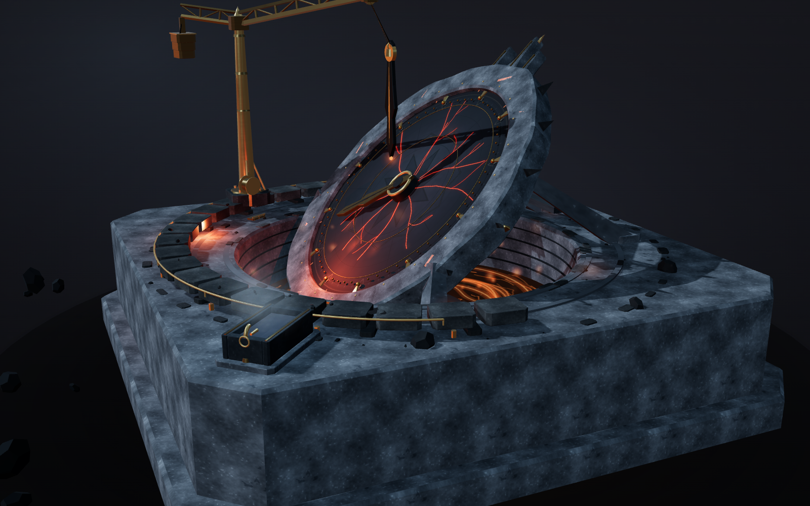
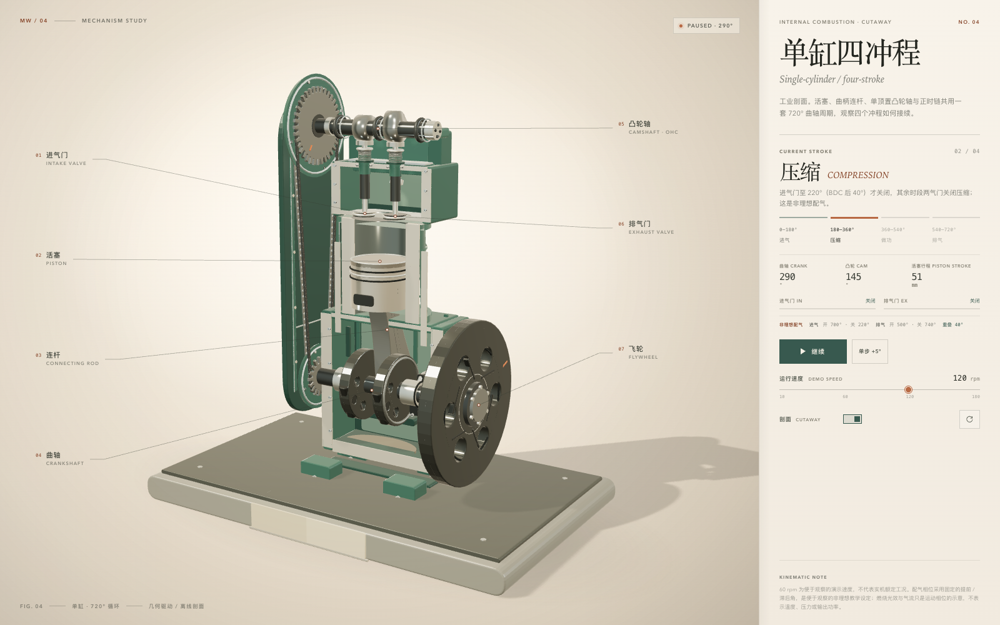
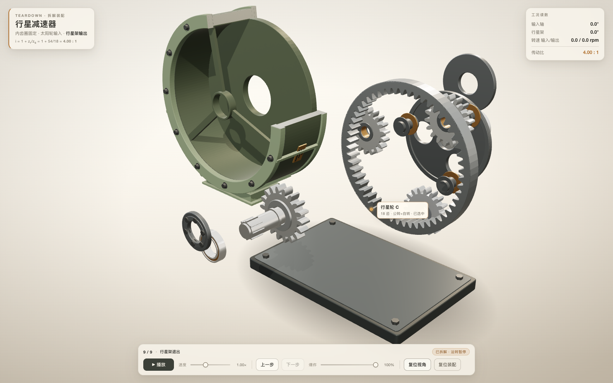
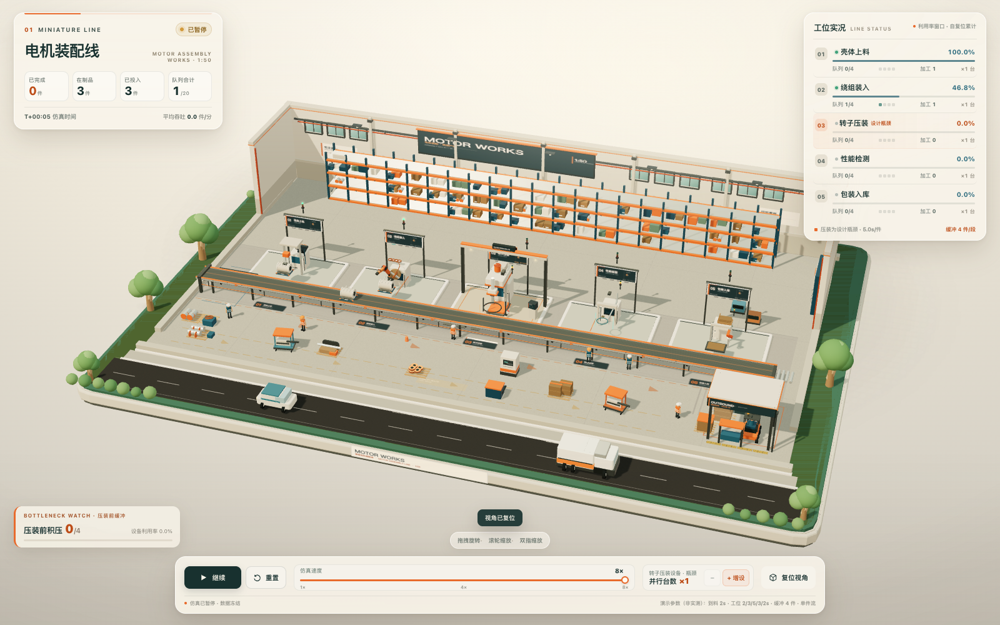

# 3D Maker Studio · 3D 造物台

[简体中文](README.md) · **English**

Turn a short description or reference image into an interactive 3D HTML project in DeepSeek Harness (DSH). Review and edit the plan, send it to a DSH session, then import the finished work for preview, revision, or download.

Choose from four workflows: scene creation, mechanical motion, exploded views, and miniature production lines. The last three can suggest editable parameters from your description. Quantities you leave unspecified are estimates for the demonstration. Preview each result to verify its appearance, motion, and controls.

[](docs/screenshots/workbench.png)

## Gallery

These screenshots show interactive HTML projects made with the workbench. Click a screenshot to enlarge it.

| Neon Rain in Kowloon | Molten Stardial |
| --- | --- |
| [](docs/screenshots/neon-rain-kowloon.png) | [](docs/screenshots/molten-stardial.png) |
| **Single-cylinder four-stroke engine** | **Planetary gearbox** |
| [](docs/screenshots/four-stroke-engine.png) | [](docs/screenshots/planetary-gearbox.png) |

Follow parts through workstations, queues, and dispatch in the **motor assembly line**.

[](docs/screenshots/motor-assembly-line.png)

## Install and make your first project

1. Install [DeepSeek Harness Desktop](https://www.deepseek.com/harness/). Start with DSH **0.2.2-rc.3** and the Simplified Chinese interface for automatic handoff to a native session. The package declares DSH 0.2.2-rc.1 as its minimum. See the release notes for the tested versions and platforms.
2. Download `dsh-external-dsh-miniature-atelier-0.24.19.tgz` from the [v0.24.19 preview release](https://github.com/jinxingtaire/dsh-miniature-atelier/releases/tag/v0.24.19), or copy the asset's download URL.
3. In the DSH sidebar, open **Plugins → Add plugin** (插件 → 添加插件). Paste the asset URL or the absolute path to the local `.tgz`. Install and enable it, then reload if prompted. In v0.24.19 the sidebar entry is labeled **微缩工坊**. The desktop app supplies the runtime, including Node.js and the package manager, and the plugin bundles Three.js. A GitHub source archive needs to be built first.
4. Sign in to your own **DeepSeek account** inside DSH and check that a standard DSH session can reply. Open **微缩工坊 → 创作** and choose **机械运转** (Mechanical motion). Try this prompt:

   > Build a continuously running slider-crank mechanism. Show the crank driving the slider back and forth through a connecting rod. Set the default speed to 45 rpm and add pause and single-step controls.

5. Wait for suggestions or click **按描述填充** (Fill from description). Review the speed and motion constraints, edit them if needed, then click **在 DSH 制作** (Create in DSH). Watch the new session for the finished file. If automatic handoff is unavailable in your host version or locale, paste the copied task into a standard DSH session.
6. After the session completes, open **作品** (Works), refresh discovery, and import the result. Open it to check the interaction and download it if needed. The default output location is `./miniature-runs` relative to the session workspace. You can change it in the task draft. To revise a work, open it, describe the change, and import the new file once it is ready.

For supported installation sources, see the [DSH Plugin Manager documentation](https://github.com/deepseek-ai/deepseek-harness/tree/master/packages/client/ui-plugin-manager).

## DeepSeek connection and local data

| Feature | Runtime and requirements |
| --- | --- |
| Parameter suggestions, creative intent, concepts, and prompt refinement | The DSH `llm` service calls `deepseek-account / deepseek-flash` using your signed-in account and its usage allowance. |
| Reference-image analysis | The image is saved locally. The plugin opens a dedicated DSH session that uses the host's image-reading tools and the same model service. |
| Creation and revision | A native DSH session uses the selected model, tool permissions, and workspace. The task supplies the path to the bundled Three.js r160 file. Browser checks depend on the session's available tools. |
| Drafts, templates, and existing works | You can edit locally. Self-contained HTML works can open offline in a WebGL-capable browser. External reference links and their remote covers require a network connection. |

The plugin uses the host's connection. There is no plugin-specific API key or backend to configure. **Automatic parameter suggestions, concepts, and image analysis require signing in to a DeepSeek account in DSH.** If you use only an API key in the host, enter parameters manually and send the copied task to a native session that uses your configured model.

The plugin uses DSH's same-origin API. A GET request to `/api/miniature-atelier/design` reports whether the plugin route is ready. Check the model login, usage allowance, and connectivity separately. Prompts and relevant observations can be sent to the model. Reference images are stored under the host's local data directory, drafts and imported works use local client storage, and generated files live in the session workspace. Download important drafts and works as backups.

## Troubleshooting

- **The sidebar entry is missing.** Check that the plugin is enabled in the active DSH profile, verify the host version, and reload when prompted.
- **Suggestions fail or never appear.** Try a normal DSH session to check your login, connection, and usage allowance, then click **按描述填充** to retry. You can also choose **使用手填参数** (Use manual parameters).
- **Image analysis fails.** Retry with a smaller JPEG or PNG and check that the host can read images and write files. You can describe the image manually.
- **The session produced HTML but it does not appear in Works.** Wait for completion, refresh, and check the search filter. Load earlier sessions or import the finished HTML by session ID.
- **A work opens to a blank page.** Check WebGL and the browser console, and make sure you imported the final, self-contained HTML. Results depend on the task and session tools.

## Build from source

The project builds and runs its tests using the Node.js standard library. It declares Node.js 20 or later. If you run the DSH host separately from npm, `@deepseek-ai/dsh@0.2.2-rc.3` requires Node.js 24.9 or later. The desktop app supplies its own runtime.

```sh
npm run build
npm test
npm pack
```

See the [creation and revision workflow](WORKFLOW.en.md) for details. When reporting a bug, include your DSH version, OS, plugin version, reproduction steps, and error text with personal data removed.

## Credits and license

Thanks to **AirsupHQ** for machine-skill and factory-skill, and **elvarofficial** for teardown. These projects provided design references for mechanical cutaways, exploded views, and miniature production lines. The workbench implements these workflows for DSH. [Full credits and reference revisions](THIRD_PARTY_NOTICES.md)

Thanks to **DeepSeek Harness** for the plugin host, **Three.js** for rendering, and **SandBase Lab** and the individual creators for the reference catalog and linked examples. The project source is available under the MIT license. [Project license](LICENSE) · [Third-party notices](THIRD_PARTY_NOTICES.md)
